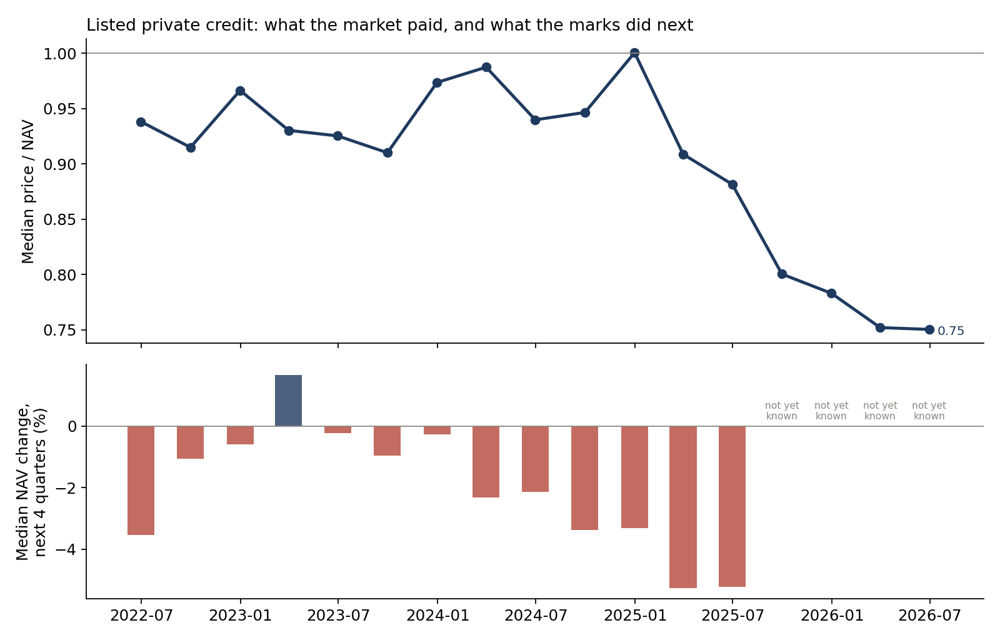
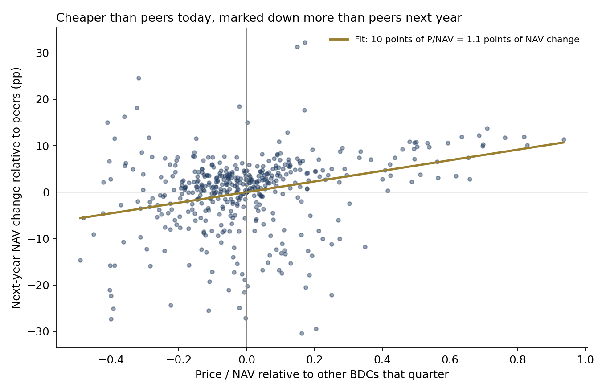
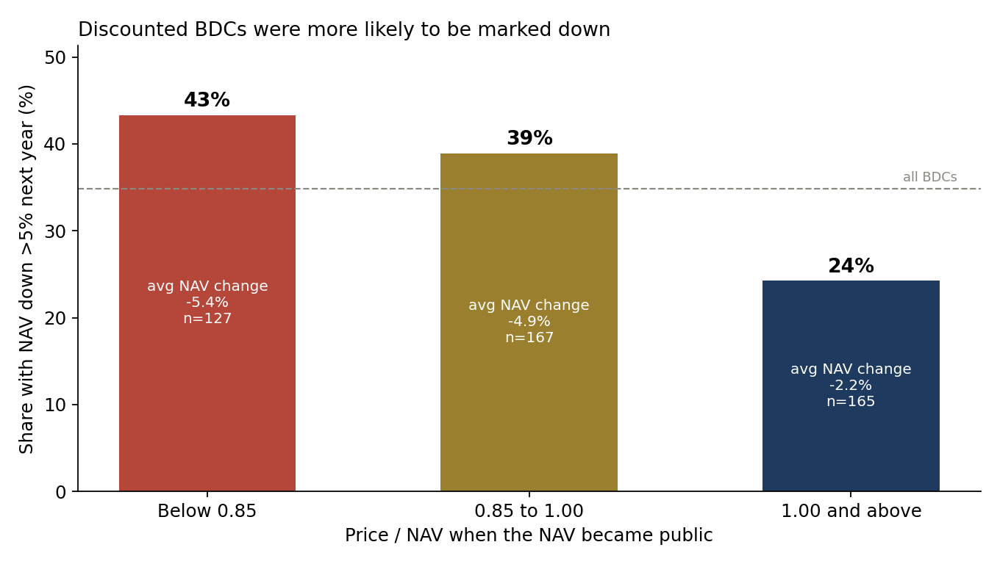
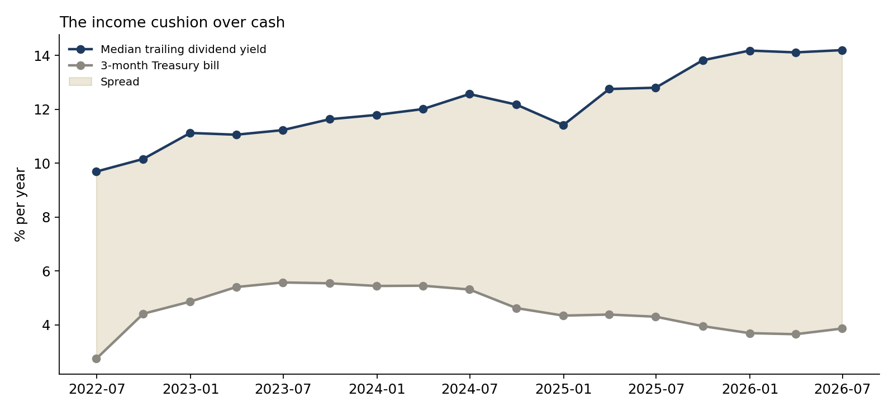

# Does the BDC discount see private-credit markdowns before the marks do?

**Question.** Private loans are valued by their managers, quarterly, with no market price. Listed business development companies (BDCs) hold those loans and also trade every day. If the stock market prices a BDC well below its reported net asset value (NAV), is that noise, or is it an early read on the markdowns still to come? And what should a valuation committee do with that read?

**Answer, on real data.** Across 44 listed BDCs and 459 BDC-quarters (NAVs from mid-2022, outcomes to mid-2025), a BDC that traded cheaper than its peers once its NAV was public was marked down more than its peers over the following year. The within-quarter rank correlation between price/NAV and the next year's NAV change averaged 0.26 and was positive in all 13 quarters (t = 7.2). With quarter fixed effects, 10 points of price/NAV corresponded to 1.1 points of NAV change over the next year (slope 0.114, se 0.021). The discount still carried information after controlling for the manager's own trailing marks (slope 0.084, se 0.019), and the relation was stronger in the 2024–25 stress (0.15) than in 2023–24 (0.06). Among BDCs below 0.85× NAV, 43% cut NAV by more than 5% within a year, against 24% for those at a premium. Yet the deep-discount group's shareholders earned 6.1% over the next 12 months, about the same as the premium group: the price had already absorbed the markdown. Today (prices of 19 October 2026, NAVs of 30 June 2026) the median BDC trades at 0.66× NAV, 75% are below 0.85× and the median trailing dividend yield is 15.1% against a 4.27% Treasury bill.

Full write-up: https://www.guptagaurav.info/articles/bdc-discount

## Results

| Test (459 BDC-quarters, 44 BDCs) | Result |
|---|---|
| Rank correlation, price/NAV vs next-year NAV change, within quarter | mean 0.26, positive in 13 of 13 quarters, t = 7.2 |
| Fixed-effects slope, NAV change on price/NAV (n = 304) | 0.114 (se 0.021), R² 0.09 |
| Trailing 12-month NAV change alone | 0.525 (se 0.058), R² 0.21 |
| Both together | price/NAV 0.084 (se 0.019); trailing 0.478 (se 0.058); R² 0.26 |
| Stability: outcome quarters May 2023 – Jun 2024 / Aug 2024 – Jun 2025 | 0.061 (se 0.028) / 0.154 (se 0.030) |
| NAV treated as public 75 / 90 days after quarter-end instead of 50 | slope 0.117 / 0.123; positive in 13 of 13 quarters both times |

| Price / NAV when the NAV became public | n | Median P/NAV | Avg NAV change, next year | Median | NAV down > 5% | 12-month total return | Dividend yield |
|---|---|---|---|---|---|---|---|
| Below 0.85 | 127 | 0.77 | −5.4% | −4.1% | 43% | 6.1% | 13.0% |
| 0.85 to 1.00 | 167 | 0.93 | −4.9% | −3.7% | 39% | 0.3% | 11.5% |
| 1.00 and above | 165 | 1.10 | −2.2% | −0.2% | 24% | 5.4% | 10.5% |

A simple governance flag, "price below 0.85× NAV", picked out 43% of the BDCs that went on to mark down by more than 5%, against a 35% base rate (recall 34%). It is a prompt for challenge, not a forecast.

| Sector, median across BDCs | Jun 2022 | Dec 2024 | Jun 2025 | Jun 2026 | 19 Oct 2026 |
|---|---|---|---|---|---|
| Price / NAV (price 50 days after the NAV date) | 0.94 | 1.00 | 0.88 | 0.75 | 0.66 (latest NAV) |
| NAV change over the next year | −3.5% | −3.3% | −5.2% | not yet known | |
| Trailing dividend yield vs 3-month T-bill | 9.7% vs 2.7% | 11.4% vs 4.3% | 12.8% vs 4.3% | 14.2% vs 3.9% | 15.1% vs 4.3% |

Illustrative valuation-governance translation: on a $1bn private-credit book, 10 points of discount relative to peers corresponded to about $11.4M of subsequent markdown.






## Method

- **Universe.** Every listed US company whose Yahoo business summary describes it as a business development company, less notes, preferreds, ETNs and non-lending vehicles (`configs/default.yaml`). A BDC enters once it has quarterly NAV and a trading price.
- **NAV per share.** Quarterly common equity divided by shares outstanding from the balance sheet, with historical share counts restated for later splits so they match split-adjusted prices.
- **No look-ahead.** A quarter's NAV is treated as public 50 days after quarter-end (the 10-Q deadline is 40–45 days); price/NAV uses the first close on or after that date. Robustness at 75 and 90 days covers 10-K year-end filings. No price is used before a stock's listing.
- **Outcome.** Change in NAV per share over the next four quarters. Trailing marks: NAV change over the previous four quarters.
- **Tests.** Spearman correlation within each quarter; pooled OLS with quarter fixed effects (demeaned within quarter), with and without trailing marks; first-half and second-half stability; three price/NAV buckets; a 0.85× flag.
- **Data-quality screen (added after the first run).** The first run showed NAV-per-share jumps of 50–100% in a quarter (GLAD, OCSL, KBDC, NCDL, NSLR) that came from share-count, reverse-split or pre-listing artefacts in the source data. Any observation whose trailing or forward year spans a quarter-on-quarter NAV-per-share move above 25% is dropped (38 BDC-quarters; listed in `metrics.json`). This also removes any genuine single-quarter collapse above 25%, which makes the reported relation conservative. Before the screen the slope was 0.150 and trailing marks looked useless; the screened numbers above are the ones to use.

## Limits

- **Survivorship.** The universe is BDCs listed today. BDCs that merged or delisted between 2022 and 2026 are missing, and they were probably more often the deep-discount ones.
- **Short window.** Quarterly statements in this source begin in 2022, so the outcomes cover one credit cycle (2022–25). Four years is not a full cycle test.
- **Balance-sheet NAV from Yahoo** rather than each BDC's reported NAV per share; small differences arise from share counts at different dates.
- **Cross-sectional, not a sector forecast.** The fixed-effects slope ranks BDCs against each other within a quarter. It does not say how far the whole sector's NAV will fall from today's 0.66×.
- The discount also reflects fees, leverage, liquidity and dividend cuts, not only credit marks.
- Independent research on public data; not investment advice and not deployed.

## Data and citations

Data
- BDC daily closes, dividend and split events, quarterly balance sheets and company profiles, and the 3-month Treasury bill yield, Yahoo Finance. Copy used: [huggingface.co/datasets/defeatbeta/yahoo-finance-data](https://huggingface.co/datasets/defeatbeta/yahoo-finance-data) (ODC-BY). Files pinned by sha256 in `configs/default.yaml`.

Context and methods referenced
- Lee, C., Shleifer, A. and Thaler, R. (1991). "Investor Sentiment and the Closed-End Fund Puzzle." *The Journal of Finance* 46(1), 75–109.
- Pontiff, J. (1995). "Closed-end fund premia and returns: Implications for financial market equilibrium." *Journal of Financial Economics* 37(3), 341–370.
- Cherkes, M., Sagi, J. and Stanton, R. (2009). "A Liquidity-Based Theory of Closed-End Funds." *The Review of Financial Studies* 22(1), 257–297.
- US Securities and Exchange Commission (2020). "Good Faith Determinations of Fair Value," Rule 2a-5 under the Investment Company Act, Release No. IC-34128.

All code, charts and text are the author's own.

## Run it

```bash
pip install -r requirements.txt
make all     # downloads the pinned files, verifies sha256, runs the pipeline
make test
```

Outputs: `reports/metrics.json`, `reports/panel.csv`, `reports/latest_snapshot.csv`, `reports/figures/`. Architecture: [docs/ARCHITECTURE.md](docs/ARCHITECTURE.md).

*Independent research on public data. Not investment advice. Dollar figures are illustrative.*
