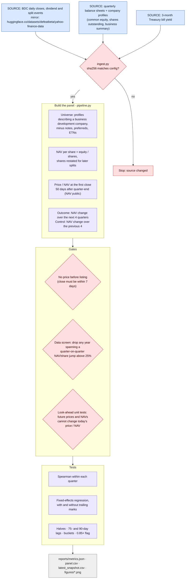
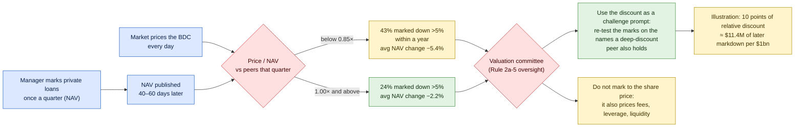

# How this project works

Two diagrams:
1. **Pipeline**: every step, its source file, and the gates that stop bad data.
2. **The signal and the decision**: what the discount says and how a valuation committee should use it.

Colour key: **blue** = external data or market input · **lavender** = code step · **red** = check, gate or decision · **green** = good outcome · **yellow** = caution · **grey** = output

## 1. Pipeline (what `make all` runs)

## 2. The signal and the decision

